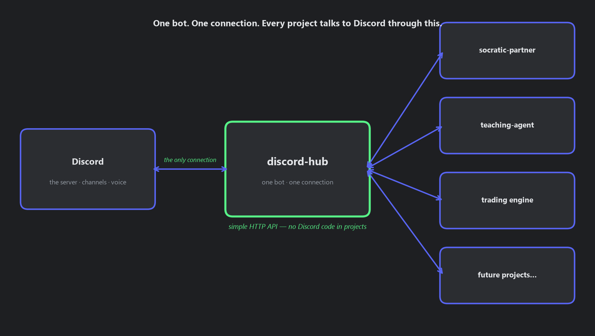

# discord-hub

**One bot. One connection. Every project talks to Discord through this.**



## Why this exists (the thesis)

Several of my projects need to interact with Discord — Socratic Partner
sends messages, the Teaching Agent will hold voice conversations, and more
will come. Without this project, each of those would contain its own copy
of "how to talk to Discord": its own bot, its own token handling, its own
reconnect logic, its own voice code. That's the same problem solved badly
in five places.

discord-hub solves it once. It is a single, always-running bot that owns
the *only* Discord connection in the whole system. Other projects never
import a Discord library and never hold a token. They just make simple
local API calls like "send this text to this channel" or "join this voice
channel and play this audio."

Because the hub is always online and connected to the whole server, it can
also act as the server's caretaker: it can report how the server is
structured (channels, roles, members), and — only with explicit permission
— propose and carry out changes to that structure.

## The one rule that keeps this clean

**The hub knows Discord. It knows nothing about conversations.**

Whether a project allows one chat at a time or a hundred, whether messages
need AI replies or are just notifications — those are *project* rules and
live in the projects. The hub only routes: "a message arrived in channel X
→ deliver it to the project that owns channel X."

## How other projects use it

The hub runs on the local machine and exposes a small HTTP API
(`localhost:8100` by default). A project calls endpoints such as:

- `POST /messages` — send a text message to a channel
- `GET /server/structure` — see the server's channels, roles, and layout
- Voice: join/leave/play, plus a full-duplex websocket stream
  (per-speaker audio in, PCM out, speaking events)

Incoming Discord messages are delivered to the project that registered
for that channel, via a webhook-style callback.

See `docs/integrating.md` for the consumer guide, `docs/api.md` for the full
contract, and `docs/architecture.md` for how it works inside.

## Running it

The hub runs inside the automation-harness (sibling repo), which owns the
lifecycle: single-instance lock, supervision with restart, graceful
shutdown, structured logs, and `data/status.json`.

```bash
pip install -e ../automation-harness   # not on PyPI; install from sibling
pip install -e .
python -m discord_hub.main
```

Requires a `.env` (see `.env.example`). Runtime state lives in `data/`
(ignored by git).

## Status

Text routing, threads, webhook identity, project-owned slash commands,
message edits (send + detect), and full-duplex voice (send + receive with
speaking events) are implemented and live-verified. See `docs/roadmap.md` and `docs/reviews/` for scope,
evidence, and remaining work.

## Tests (no live Discord required)

```bash
python -m pip install -e ".[dev]"
python -m unittest discover -s tests -v
```

Tests use temporary state and fake Discord operations; callbacks run on local
HTTP servers. They do not modify real registrations or consuming projects.
